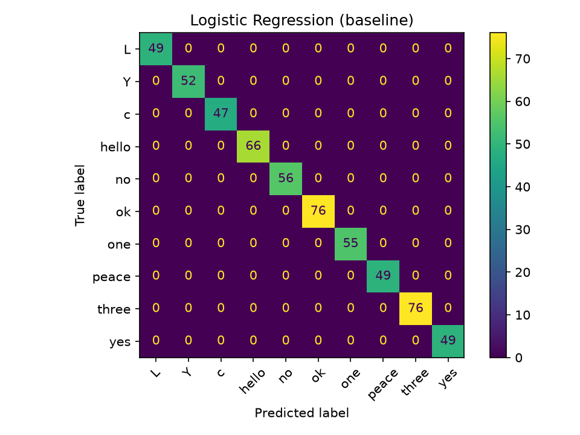
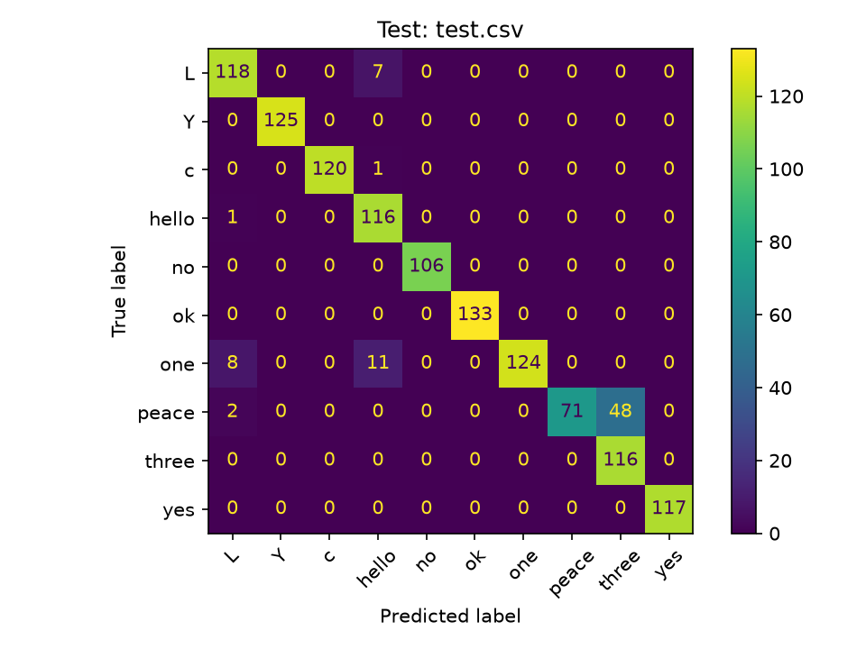

# Hand-Sign Recognition with a Custom ML Model

Real-time hand-sign recognition built with **OpenCV, MediaPipe and scikit-learn**. The model is trained on a **self-collected landmark dataset**, and the live demo builds a sentence from the signs and speaks it aloud.

> Status: working prototype with 10 static, one-hand signs (not full Indian Sign Language).

## Demo
Video: `demo.mp4`. Hold a sign for about 1 second and it is added to the sentence and spoken.

## How it works

    Camera -> MediaPipe (21 hand landmarks) -> Normalize -> Classifier -> Sign + confidence
           -> Smoothing (majority vote over last 10 frames) -> Sentence + text-to-speech

1. **Landmarks:** MediaPipe returns 21 points (x, y, z), which is 63 numbers per frame.
2. **Normalization (`utils.py`):** points are made relative to the wrist and divided by hand size, so the model sees only the hand *shape*, not its position on screen or its distance from the camera.
3. **Model:** Logistic Regression (baseline), KNN and Random Forest were compared, and the best one is saved as `model.pkl`.
4. **Live demo (`live.py`):** predictions are smoothed over 10 frames and low-confidence predictions are ignored, so the output does not flicker.

## Signs (10)
`hello`, `yes`, `no`, `peace`, `one`, `three`, `L`, `Y`, `ok`, `c`

## Dataset
- `data.csv`: 2,875 labelled samples (about 230 to 380 per sign), recorded by me with `collect.py`.
- `test.csv`: 1,224 samples from a **separate recording session** with different distance, lighting and tilt.

## Results

| Evaluation | Accuracy |
|---|---|
| Random 80/20 split (Logistic Regression, KNN, Random Forest) | 100% |
| **Separate recording session (`test.csv`)** | **93.6%** |

### Why two numbers?
The webcam records about 30 frames per second, so neighbouring frames are almost identical. A random split puts near-copies of training frames into the test set, which makes 100% **overly optimistic**. The separate-session test is the honest number.

### What I found and fixed
- First separate-session result: **74.7%**.
- A label-case mistake in the test file (`y` vs `Y`) and an inconsistent hand shape for `three` were the main causes.
- After fixing the labels, adding more varied training samples and re-recording `three` consistently: **93.6%**.
- Note: the training data was adjusted after seeing the first test result, so 93.6% is slightly optimistic.

## Limitations
- One user, one camera and one hand, so results on other people are untested.
- `peace` is the weakest sign (recall about 0.59), and `three`, `hello` and `ok` can be confused.
- Static signs only. Signs that need motion are future work.
- Not real Indian Sign Language, which uses two hands and movement.

## Future work
- Test on other people and report the accuracy.
- Add more signs and two-hand support.
- Use sequences of frames to recognize motion signs.

## Run it

    pip install -r requirements.txt
    python collect.py      (record signs, file name: data.csv)
    python train.py        (train and compare models, saves model.pkl)
    python live.py         (live demo, Q = quit, C = clear sentence)
    python evaluate.py     (test on another recording, e.g. test.csv)

The hand model (`hand_landmarker.task`) is downloaded automatically on the first run.

## Tech
Python, OpenCV, MediaPipe, scikit-learn, pandas, NumPy, matplotlib, pyttsx3